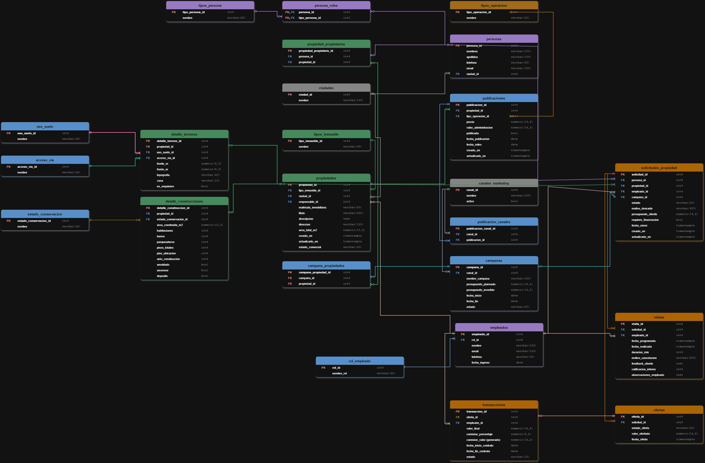

# Normalización: de 1FN a BCNF

**Equipo:** Harold Burgos, Sofía Camelo, Juan Triana  
**Esquema:** BD_MCS v1.3 · 24 tablas · base `inmobiliaria_mcs`



Revisamos el esquema forma por forma. No partimos tablas que ya cumplían. Abajo está el diseño que descartamos, la decisión que tomamos y cómo quedó el modelo. El detalle de dependencias está en `E3_modelo_relacional_normalizacion.md`. Los archivos JSON de esta carpeta repiten las mismas claves y dependencias en formato de tabla.

---

## 1FN — Valores atómicos

| Criterio | Cumplimiento |
|----------|----------------|
| Cada celda un solo valor atómico | ✅ 24/24 tablas |
| N:M y listas → filas en tablas puente | `propiedad_propietarios`, `publicacion_canales`, `campana_propiedades`, `persona_roles` |

**Contraejemplo evitado:** una fila de propiedad con columna `propietarios = "Ana, Luis"` y `canales = "Meta; web"`. Eso viola 1FN y rompe consultas.

**Decisión:** muchos valores = muchas filas con FK, no texto concatenado.

---

## 2FN — Sin dependencias parciales de la PK

| Criterio | Cumplimiento |
|----------|----------------|
| PK compuesta solo en `persona_roles` | Sin atributos no llave → no hay parcial |
| Puentes con PK subrogada | Solo FKs + id; sin descriptores que dependan de una FK suelta |
| Dueños | `nombres` solo en `personas`, no en `propiedad_propietarios` |

**Resultado:** 24/24 en **2FN**.

---

## 3FN — Sin dependencias transitivas de no primos

| Hecho de negocio | Dónde vive (no copiado) |
|------------------|-------------------------|
| Nombre de ciudad | `ciudades` vía `propiedades.ciudad_id` |
| Canal de una solicitud | `solicitud → campana → canal` (R10) |
| Propiedad de una visita | solo vía `solicitud_id` (R8) |
| Rol del empleado | `rol_empleado` vía `empleados.rol_id` |

**`comision_valor` (R16):** depende de `valor_final` y `comision_porcentaje`. No se digita: columna **GENERATED** en PostgreSQL. Se documenta como derivada; no se descompone a otra tabla.

**Resultado:** 24/24 en **3FN** (con nota documentada de la columna generada).

---

## BCNF — Todo determinante es superclave

En las dependencias funcionales del proyecto, el lado izquierdo es siempre PK, candidata (UNIQUE) o clave natural de un puente.

No hay DF del tipo “atributo no llave → otro atributo no llave”, salvo la comisión derivada (no almacenada como hecho editable).

**Resultado:** 24/24 en **BCNF** sin descomposiciones innecesarias.

---

## Recorrido del diseño

```text
Diseño con listas en celdas           → viola 1FN
  ↓ puentes y columnas atómicas
1FN (24 tablas)
  ↓ sin descriptores en PK compuesta / puentes
2FN
  ↓ ciudad, canal, rol, título por JOIN; visitas sin copiar propiedad
3FN
  ↓ determinantes = superclaves; comision_valor generada
BCNF — BD_MCS v1.3
```

---
