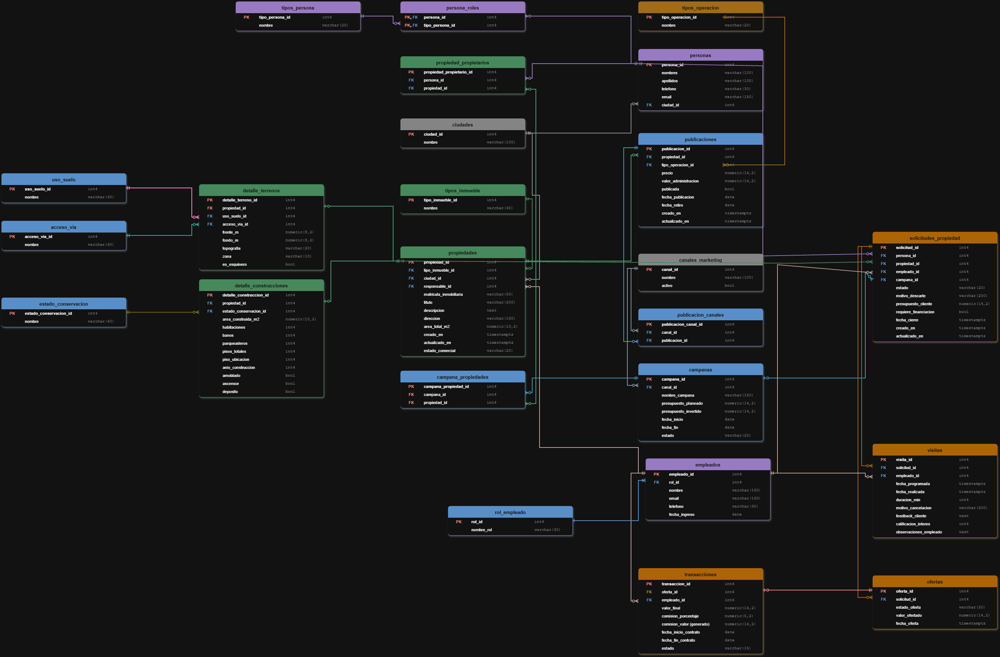

# Modelo relacional y normalización

**Equipo:** Harold Burgos, Sofía Camelo, Juan Triana  
**Base:** `inmobiliaria_mcs`  
**Versión:** BD_MCS v1.3. El archivo se llama `modelo_relacional_2.0.drawio`; ese 2.0 es el nombre del archivo, no otra versión del esquema. El conceptual de origen es v2.3 (`modelo_conceptual_2.1.drawio`).



El esquema tiene 24 tablas. Si una tabla ya está en BCNF, la dejamos así. El diagrama editable es `modelo_relacional_2.0.drawio`. Las reglas de negocio son las del documento de formulación.

---

## 1. Transformación ER/EER → relacional

Reglas aplicadas:

| Construcción conceptual | Resultado relacional |
|-------------------------|----------------------|
| Entidad fuerte | Tabla con PK subrogada (`*_id`) |
| Relación 1:N | FK en el lado N |
| Relación N:M | Tabla puente |
| Especialización 1:0..1 | Tabla hija con FK **única** al padre |
| Atributo derivado | Columna generada (no se digita) |
| Participación opcional | FK nullable (`campana_id`, `empleado_id` en solicitud) |

### 1.1 Entidades fuertes → tablas

Las diez entidades de proceso y los catálogos del conceptual pasan 1:1 a tablas del mismo nombre: `personas`, `propiedades`, `publicaciones`, `campanas`, `solicitudes_propiedad`, `visitas`, `ofertas`, `transacciones`, `empleados`, más catálogos (`ciudades`, `tipos_*`, `canales_marketing`, `rol_empleado`, `estado_conservacion`, `uso_suelo`, `acceso_via`).

`empleados` no se fusiona con `personas`: el staff no es cliente (alcance E1). No hay redundancia de 3FN; son conjuntos distintos.

### 1.2 Relaciones 1:N → FK

Ejemplos que sostienen las preguntas de información:

- `propiedades.ciudad_id` → `ciudades` (pregunta 1: ubicación).
- `solicitudes_propiedad.persona_id` → `personas` y `.propiedad_id` → `propiedades` (R6: prospecto ≠ dueño).
- `visitas.solicitud_id` → `solicitudes_propiedad` (R8: la visita no copia `propiedad_id` ni `persona_id`; se obtienen por JOIN).
- `ofertas.solicitud_id` → `solicitudes_propiedad` (R9).
- `campanas.canal_id` → `canales_marketing` (pregunta 6).

### 1.3 Relaciones N:M → puentes

| Puente | Claves foráneas | Regla |
|--------|-----------------|-------|
| `persona_roles` | `persona_id`, `tipo_persona_id` | R13. PK **compuesta**. |
| `propiedad_propietarios` | `persona_id`, `propiedad_id` | R2. PK subrogada + UNIQUE del par. |
| `publicacion_canales` | `publicacion_id`, `canal_id` | R3. |
| `campana_propiedades` | `campana_id`, `propiedad_id` | R3, R4. |

`solicitudes_propiedad` **no** es el puente de dueños. Si se usara `propiedad_propietario_id` como FK de la solicitud, el interesado quedaría atado al dueño y las preguntas 2–8 dejarían de ser respondibles.

### 1.4 Especialización → tablas hijas

`detalle_construcciones` y `detalle_terrenos` tienen `propiedad_id` UNIQUE (1:0..1). No hay XOR: una casa sobre lote puede tener ambas filas (R15). Un lote puede no tener construcción.

### 1.5 Atributo derivado

`transacciones.comision_valor` = `valor_final * comision_porcentaje / 100` (R16). En PostgreSQL será `GENERATED ALWAYS`. No es un hecho independiente.

---

## 2. Tabla de claves primarias, candidatas y foráneas

Notación: **CC** = clave candidata además de la PK. Las FK nullable se marcan con *sí (N)*.

| Relación | PK | Claves candidatas | FK → tabla destino | Nullable |
|----------|----|-------------------|--------------------|----------|
| `ciudades` | `ciudad_id` | `nombre` | — | — |
| `tipos_persona` | `tipo_persona_id` | `nombre` | — | — |
| `tipos_inmueble` | `tipo_inmueble_id` | `nombre` | — | — |
| `tipos_operacion` | `tipo_operacion_id` | `nombre` | — | — |
| `estado_conservacion` | `estado_conservacion_id` | `nombre` | — | — |
| `uso_suelo` | `uso_suelo_id` | `nombre` | — | — |
| `acceso_via` | `acceso_via_id` | `nombre` | — | — |
| `rol_empleado` | `rol_id` | `nombre_rol` | — | — |
| `canales_marketing` | `canal_id` | `nombre` | — | — |
| `personas` | `persona_id` | `email` | `ciudad_id` → `ciudades` | no |
| `persona_roles` | (`persona_id`, `tipo_persona_id`) | la misma PK | `persona_id` → `personas`; `tipo_persona_id` → `tipos_persona` | no / no |
| `empleados` | `empleado_id` | `email` | `rol_id` → `rol_empleado` | no |
| `propiedades` | `propiedad_id` | `matricula_inmobiliaria` | `tipo_inmueble_id` → `tipos_inmueble`; `ciudad_id` → `ciudades`; `responsable_id` → `empleados` | no / no / no |
| `propiedad_propietarios` | `propiedad_propietario_id` | (`persona_id`, `propiedad_id`) | `persona_id` → `personas`; `propiedad_id` → `propiedades` | no / no |
| `detalle_construcciones` | `detalle_construccion_id` | `propiedad_id` | `propiedad_id` → `propiedades`; `estado_conservacion_id` → `estado_conservacion` | no / no |
| `detalle_terrenos` | `detalle_terreno_id` | `propiedad_id` | `propiedad_id` → `propiedades`; `uso_suelo_id` → `uso_suelo`; `acceso_via_id` → `acceso_via` | no / no / no |
| `publicaciones` | `publicacion_id` | — | `propiedad_id` → `propiedades`; `tipo_operacion_id` → `tipos_operacion` | no / no |
| `publicacion_canales` | `publicacion_canal_id` | (`publicacion_id`, `canal_id`) | `publicacion_id` → `publicaciones`; `canal_id` → `canales_marketing` | no / no |
| `campanas` | `campana_id` | — | `canal_id` → `canales_marketing` | no |
| `campana_propiedades` | `campana_propiedad_id` | (`campana_id`, `propiedad_id`) | `campana_id` → `campanas`; `propiedad_id` → `propiedades` | no / no |
| `solicitudes_propiedad` | `solicitud_id` | — | `persona_id` → `personas`; `propiedad_id` → `propiedades`; `campana_id` → `campanas`; `empleado_id` → `empleados` | no / no / **sí** / **sí** |
| `visitas` | `visita_id` | — | `solicitud_id` → `solicitudes_propiedad`; `empleado_id` → `empleados` | no / no |
| `ofertas` | `oferta_id` | — | `solicitud_id` → `solicitudes_propiedad` | no |
| `transacciones` | `transaccion_id` | `oferta_id` | `oferta_id` → `ofertas`; `empleado_id` → `empleados` | no / no |

Punto de integridad (R6): `solicitudes_propiedad` referencia `personas` y `propiedades`, **no** `propiedad_propietarios`.

`campana_id` y `empleado_id` en solicitud son opcionales: el lead puede llegar sin campaña atribuible (R10) y asignarse después al asesor.

No hay UNIQUE sobre (`persona_id`, `propiedad_id`) en solicitudes: un prospecto puede reabrir interés (nueva solicitud) después de una oportunidad `descartada` o `perdida`. Eso es semántica, no una forma normal.

---

## 3. Dependencias funcionales relevantes

Se listan las DF no triviales que importan para 2FN/3FN/BCNF. En catálogos, el patrón es el mismo: `id → nombre` y `nombre → id`.

Convención: el lado izquierdo determina el derecho.

### 3.1 Catálogos

```text
ciudad_id → nombre
nombre → ciudad_id                          -- UNIQUE de negocio
tipo_persona_id → nombre
tipo_inmueble_id → nombre
tipo_operacion_id → nombre
estado_conservacion_id → nombre
uso_suelo_id → nombre
acceso_via_id → nombre
rol_id → nombre_rol
canal_id → nombre, activo
```

### 3.2 Personas y empleados

```text
persona_id → nombres, apellidos, telefono, email, ciudad_id
email → persona_id                          -- CC
empleado_id → nombre, email, telefono, fecha_ingreso, rol_id
email → empleado_id                         -- CC (correo corporativo)
```

`persona_roles` no tiene atributos no llave. La única DF es la trivial de la PK compuesta.

### 3.3 Propiedades y especialización

```text
propiedad_id → matricula_inmobiliaria, titulo, descripcion, direccion,
               area_total_m2, estado_comercial, ciudad_id,
               tipo_inmueble_id, responsable_id, creado_en, actualizado_en
matricula_inmobiliaria → propiedad_id       -- R1, CC

propiedad_propietario_id → persona_id, propiedad_id
(persona_id, propiedad_id) → propiedad_propietario_id

detalle_construccion_id → propiedad_id, estado_conservacion_id,
                          area_construida_m2, habitaciones, banos, parqueaderos,
                          pisos_totales, piso_ubicacion, anio_construccion,
                          amoblado, ascensor, deposito
propiedad_id → detalle_construccion_id      -- 1:0..1, CC

detalle_terreno_id → propiedad_id, uso_suelo_id, acceso_via_id,
                     frente_m, fondo_m, topografia, zona, es_esquinero
propiedad_id → detalle_terreno_id           -- 1:0..1, CC
```

No existe `propiedad_id → nombres_propietario`: ese dato vive en `personas` vía el puente. Meterlo en `propiedades` crearía una DF transitiva (violación de 3FN) y además no cubre R2 (varios dueños).

### 3.4 Publicación y marketing

```text
publicacion_id → propiedad_id, tipo_operacion_id, precio,
                 valor_administracion, publicada, fecha_publicacion,
                 fecha_retiro, creado_en, actualizado_en
publicacion_canal_id → publicacion_id, canal_id
(publicacion_id, canal_id) → publicacion_canal_id

campana_id → canal_id, nombre_campana, presupuesto_planeado,
             presupuesto_invertido, fecha_inicio, fecha_fin, estado
campana_propiedad_id → campana_id, propiedad_id
(campana_id, propiedad_id) → campana_propiedad_id
```

`solicitud_id ↛ canal_id` de forma directa. El canal, si hay origen de campaña, se obtiene `solicitud → campana → canal`. Guardar `canal_id` en la solicitud duplicaría esa DF (3FN).

### 3.5 Pipeline comercial

```text
solicitud_id → persona_id, propiedad_id, campana_id, empleado_id,
               estado, motivo_descarte, presupuesto_cliente,
               requiere_financiacion, fecha_cierre, creado_en, actualizado_en

visita_id → solicitud_id, empleado_id, fecha_programada, fecha_realizada,
            duracion_min, motivo_cancelacion, feedback_cliente,
            calificacion_interes, observaciones_empleado

oferta_id → solicitud_id, estado_oferta, valor_ofertado, fecha_oferta

transaccion_id → oferta_id, empleado_id, valor_final, comision_porcentaje,
                 fecha_inicio_contrato, fecha_fin_contrato, estado
oferta_id → transaccion_id                  -- 1:0..1, CC
(valor_final, comision_porcentaje) → comision_valor   -- derivada (R16)
```

`visita_id ↛ persona_id` ni `propiedad_id` como atributos propios: `solicitud_id → persona_id, propiedad_id`. Copiarlos en `visitas` sería transitivo (R8 + 3FN).

---

## 4. Evidencia 1FN → 2FN → 3FN → BCNF

No se “inventan” descomposiciones. Se muestra el proceso sobre el dominio y se verifica cada forma en el esquema v1.3.

### 4.1 1FN — atomicidad

Una relación está en 1FN si cada intersección fila-columna tiene un valor atómico (sin grupos que se repiten).

**Contraejemplo que se evitó** (diseño no 1FN):

| propiedad_id | titulo | propietarios | canales |
|--------------|--------|--------------|---------|
| 1 | Apto Chapinero | Ana, Luis | Meta Ads; web |

Esa fila viola 1FN: `propietarios` y `canales` son listas. Insertar un tercer dueño obliga a reescribir la celda; consultar “inmuebles de Ana” exige parsear texto.

**En v1.3:** un teléfono, un correo, un `estado_comercial`, un `tipo_inmueble_id`. Los muchos-valores son filas en puentes (`propiedad_propietarios`, `publicacion_canales`). No hay atributos compuestos persistidos (nombre+apellido van en dos columnas atómicas).

Todas las 24 relaciones están en **1FN**.

### 4.2 2FN — no hay dependencia parcial de la PK

2FN exige 1FN y que todo atributo no primo dependa de **toda** la clave, no de un fragmento.

Solo `persona_roles` tiene PK compuesta. Esa tabla **no tiene atributos no llave**, así que no puede haber dependencia parcial.

Los otros N:M usan PK subrogada. Aun así se revisa la clave candidata natural:

| Tabla | ¿Algún atributo descriptivo depende de una sola FK? | Conclusión |
|-------|------------------------------------------------------|------------|
| `propiedad_propietarios` | No hay descriptores; solo el par de FKs | 2FN |
| `publicacion_canales` | Igual | 2FN |
| `campana_propiedades` | Igual | 2FN |

**Contraejemplo que se evitó:** poner `nombres` del dueño en `propiedad_propietarios`. Entonces `(persona_id, propiedad_id) → nombres` pero también `persona_id → nombres` (parcial). Eso se resuelve dejando `nombres` solo en `personas`.

El resto de tablas tiene PK simple: 2FN se cumple apenas hay 1FN.

Todas las 24 relaciones están en **2FN**.

### 4.3 3FN — no hay dependencia transitiva de no primos

3FN exige 2FN y: para toda DF no trivial `X → A`, `X` es superclave **o** `A` es primo.

**Transitivas que se cortaron al diseñar:**

| Si se hubiera guardado… | DF transitiva | Dónde quedó el hecho |
|-------------------------|---------------|----------------------|
| `propiedades.nombre_ciudad` | `propiedad_id → ciudad_id → nombre` | `ciudades.nombre` |
| `visitas.matricula` | `visita_id → solicitud_id → propiedad_id → matricula` | JOIN (R8) |
| `solicitudes.nombre_canal` | `solicitud_id → campana_id → canal_id → nombre` | JOIN (pregunta 6) |
| `ofertas.titulo_propiedad` | `oferta_id → solicitud_id → propiedad_id → titulo` | JOIN (R9) |
| `empleados.nombre_rol` en texto libre | `empleado_id → rol_id → nombre_rol` | `rol_empleado` |

`estado_comercial` (propiedad) y `estado` (solicitud) **no** son transitivos entre sí: describen objetos distintos (R11 vs preguntas 4 y 8).

**Columna generada.** Existe `(valor_final, comision_porcentaje) → comision_valor`. El determinante no es superclave. En papel, eso rozaría 3FN si `comision_valor` se digitara a mano (anomalía: cambiar el porcentaje y olvidar el valor). En el diseño no se digita: PostgreSQL la calcula con `round(..., 2)` (`GENERATED ALWAYS`, R16). No hay actualización independiente, no se descompone. Descomponer `comision_valor` a otra tabla no aporta integridad y complica la pregunta 10.

Todas las 24 relaciones se consideran en **3FN** con esa salvedad documentada.

### 4.4 BCNF — todo determinante de una DF no trivial es superclave

BCNF es 3FN más estricta: no se admite el “o A es primo”.

En este esquema, los determinantes de las DF de la sección 3 son siempre una PK o una CC:

- IDs subrogados (`propiedad_id`, `solicitud_id`, …).
- Unicidades de negocio (`email`, `matricula_inmobiliaria`, nombres de catálogo).
- Pares naturales de puentes (`persona_id, propiedad_id`, etc.).
- `propiedad_id` en detalles 1:0..1 y `oferta_id` en `transacciones`.

No aparece una DF del tipo “atributo no llave determina otro atributo no llave”, salvo la derivada de comisión, que no se almacena como hecho.

**No se descompone** `solicitudes_propiedad` ni `propiedades`: ya están en BCNF. Partir `solicitudes` en “origen de campaña” y “interés” crearía joins extra sin quitar ninguna anomalía (R10 se modela con FK nullable, no con otra relación).

Todas las 24 relaciones están en **BCNF**.

### 4.5 Recorrido del diseño

```text
Diseño ingenuo (listas en celdas)     → viola 1FN
  ↓ atomicidad + puentes N:M
1FN
  ↓ dueños/canales/campañas fuera de la PK parcial
2FN
  ↓ ciudad, canal, rol, matrícula por JOIN; visita sin copiar propiedad
3FN
  ↓ cada DF tiene superclave a la izquierda
BCNF  (BD_MCS v1.3, 24 tablas)
```

---

## 5. Integridad referencial, dominios y restricciones semánticas

Esto cierra el Entregable 3 y queda como contrato del DDL (Fase 4).

### 5.1 Acciones referenciales previstas

| Situación | Acción | Motivo |
|-----------|--------|--------|
| Borrar un catálogo referenciado | `RESTRICT` / `NO ACTION` | No dejar propiedades sin ciudad o tipo. |
| Borrar persona con solicitudes u ownership | `RESTRICT` | Trazabilidad (preguntas 2, 5, 10). |
| Borrar propiedad con publicaciones/solicitudes | `RESTRICT` | No perder el histórico comercial. |
| Borrar fila puente (`persona_roles`, `campana_propiedades`, …) | permitido | Solo se quita el vínculo. |
| Borrar solicitud | `CASCADE` a `visitas` y `ofertas` hijas, y de oferta a transacción | Una visita no existe sin oportunidad (R8). |

### 5.2 Dominios (CHECK / UNIQUE / NOT NULL)

| Restricción | Dónde | Regla / pregunta |
|-------------|-------|------------------|
| `matricula_inmobiliaria UNIQUE NOT NULL` | `propiedades` | R1 |
| `email UNIQUE NOT NULL` | `personas`, `empleados` | Identidad de contacto |
| `area_total_m2 > 0`, `precio > 0`, `valor_ofertado > 0` | inmueble / aviso / oferta | Dominio numérico |
| `estado_comercial IN ('disponible','en_negociacion','vendida','no_disponible')` | `propiedades` | R11 |
| `estado` solicitud IN (`nueva`,`en_seguimiento`,`en_negociacion`,`ganada`,`perdida`,`descartada`) | `solicitudes_propiedad` | Preguntas 4 y 8 |
| `estado_oferta IN ('pendiente','aceptada','rechazada','caducada')` | `ofertas` | R9; no es booleano |
| `estado` campaña IN (`planificada`,`activa`,`cerrada`) | `campanas` | Ciclo de marketing |
| `calificacion_interes BETWEEN 1 AND 5` | `visitas` | Escala de seguimiento |
| `comision_porcentaje BETWEEN 0 AND 100` | `transacciones` | R16 |
| `campana_id` NULL permitido | `solicitudes_propiedad` | R10 |
| `UNIQUE (persona_id, tipo_persona_id)` | `persona_roles` | Es la PK |
| `UNIQUE (persona_id, propiedad_id)` | `propiedad_propietarios` | Un vínculo dueño–inmueble |
| `UNIQUE (propiedad_id)` | ambos detalles | Especialización 1:0..1 |
| `UNIQUE (oferta_id)` | `transacciones` | Un cierre por oferta (R12) |

`motivo_descarte` es nullable en el modelo; en operación (trigger E4) debe exigirse si `estado = 'descartada'`. Esa regla semántica no se expresa solo con 3FN.

Coherencia `estado_comercial` ↔ publicaciones ↔ transacción: no es una DF. Se garantiza con trigger en la implementación (E4), no partiendo tablas.

### 5.3 Lo que BCNF no cubre (y no debe inventarse)

- Un prospecto no debería ser, en la misma solicitud, “el dueño de esa propiedad”. Eso es una regla de negocio cruzada (R2 vs R6), no una DF. Se puede chequear con trigger o `CHECK` con subconsulta (PostgreSQL no admite subconsultas en CHECK; queda para trigger).
- `fecha_retiro >= fecha_publicacion` y `fecha_fin >= fecha_inicio` son restricciones de dominio temporal.
- MongoDB (E6) cubrirá notas de seguimiento semiestructuradas; no se meten como `text[]` en `visitas` para no romper 1FN ni inflar el relacional.

---

## 6. Trazabilidad problema → relacional

| Pregunta E1 | Tablas mínimas (ya normalizadas) |
|-------------|-----------------------------------|
| 1 Disponibles, precio, ubicación | `propiedades` ⋈ `ciudades` ⋈ `publicaciones` |
| 2 Prospectos por propiedad | `solicitudes_propiedad` ⋈ `personas` |
| 3 Más oportunidades activas | `solicitudes_propiedad` + `GROUP BY` estado |
| 4 Estado de seguimiento | `solicitudes_propiedad.estado` |
| 5 Visitas por oportunidad | `visitas` ⋈ solicitud (sin desnormalizar) |
| 6 Campañas/canales con más leads | `solicitudes` ⋈ `campanas` ⋈ `canales_marketing` |
| 7 Prospectos, visitas, negociaciones por inmueble | agregación sobre solicitudes / visitas / ofertas |
| 8 Avance a oferta o cierre | `LEFT JOIN` ofertas / transacciones |
| 9 Tiempo sin cierre | fechas de publicación vs ausencia de transacción |
| 10 Resultado económico | `transacciones` (comisión generada) ⋈ propiedad vía oferta→solicitud |

El esquema v1.3 responde las diez preguntas **sin** copiar nombres, precios ni canales en las tablas de hechos. Esa es la evidencia de que la normalización no se pelea con el propósito del E1.

---

## 7. Contrato congelado para el DDL (Fase 4)

Estas decisiones ya no se reabren al escribir SQL. Evitan que el código “invente” semántica.

| Tema | Decisión |
|------|----------|
| Motor / base | PostgreSQL · pgAdmin 4 · `inmobiliaria_mcs` |
| PK subrogadas | `GENERATED BY DEFAULT AS IDENTITY` |
| Precio vigente (pregunta 1) | `publicaciones.publicada = TRUE`; una propiedad puede tener aviso de venta y de arriendo a la vez |
| Tiempo en comercialización (pregunta 9) | Primera `fecha_publicacion`; si no hay aviso, `propiedades.creado_en` |
| Comisión | `comision_valor NUMERIC(14,2) GENERATED ALWAYS AS (round(valor_final * comision_porcentaje / 100, 2)) STORED` |
| `campana_id` / `empleado_id` en solicitud | NULL permitido |
| `motivo_descarte` | `varchar(200)` nullable; el trigger exigirá valor si `estado = 'descartada'` |
| Puente campaña–propiedad | PK `campana_propiedad_id` |
| Solicitud | FK a `persona_id` + `propiedad_id`, nunca a `propiedad_propietarios` |
| Timestamps de auditoría | `DEFAULT now()` en `creado_en`; `actualizado_en` se mantiene con trigger |

