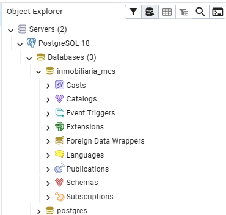
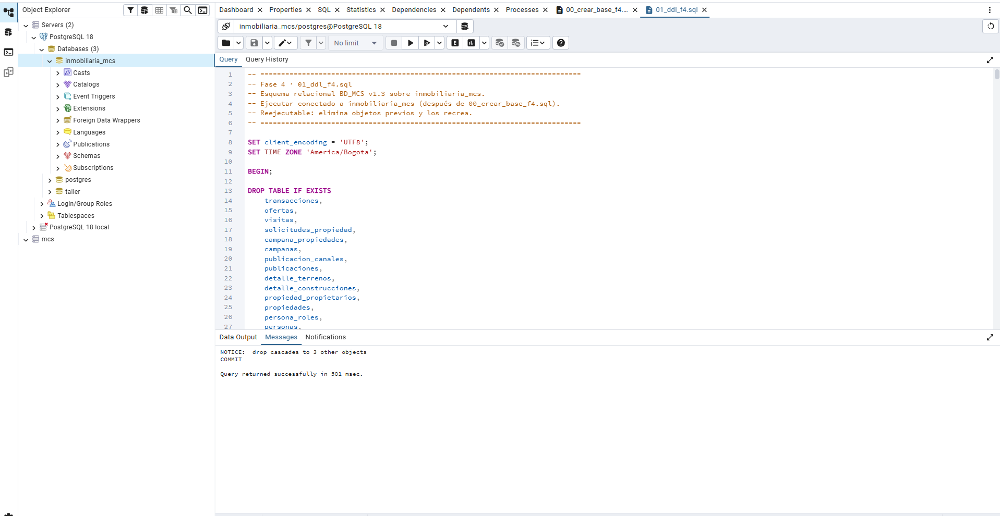
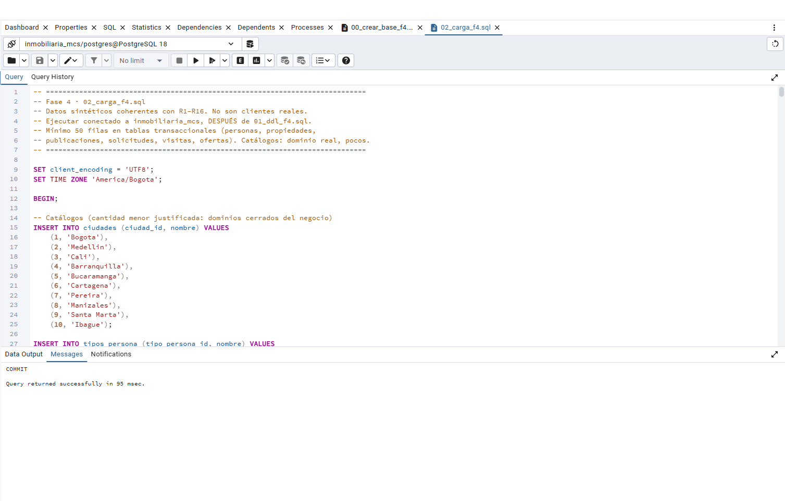
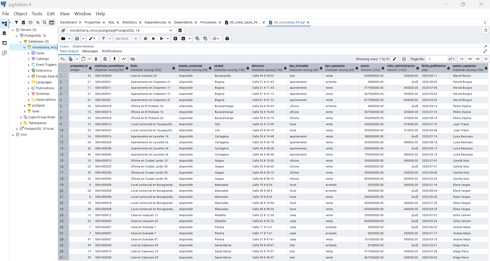
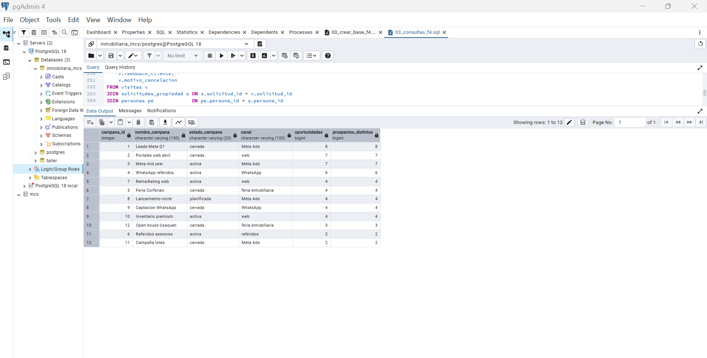
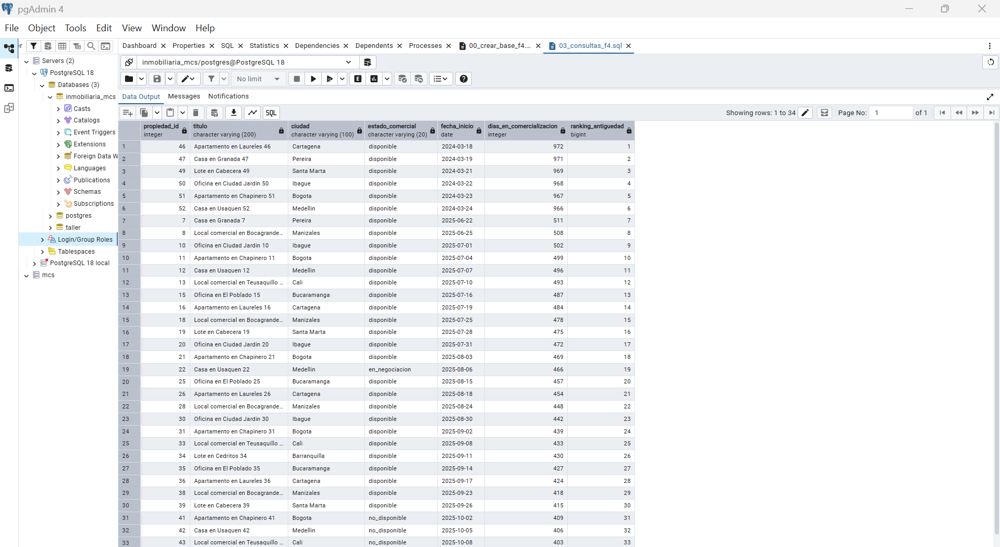
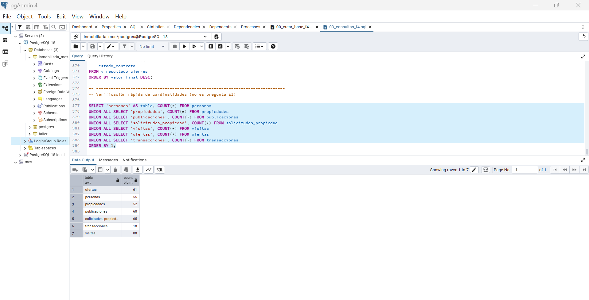
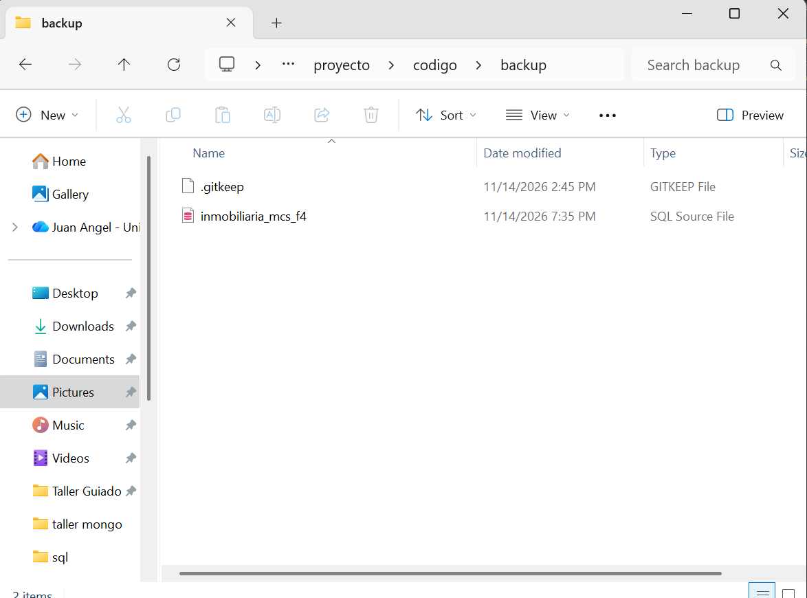

# Implementación en PostgreSQL y consultas

**Equipo:** Harold Burgos, Sofía Camelo, Juan Triana  
**Base:** `inmobiliaria_mcs`  
**Modelo:** BD_MCS v1.3

Construimos la base en PostgreSQL 18 y la administramos con pgAdmin 4. Los scripts de esta carpeta se ejecutan en este orden: `sql/00_crear_base_f4.sql` sobre la base `postgres` (solo crea `inmobiliaria_mcs`); después, ya conectados a `inmobiliaria_mcs`, `01_ddl_f4.sql`, `02_carga_f4.sql` y `03_consultas_f4.sql`.

El script de tablas define llaves, restricciones, la función `registrar_cierre` y los triggers de negocio. La carga usa datos de prueba. Los catálogos (ciudades, tipos, canales, roles) son cortos porque el dominio es cerrado. Las tablas del proceso superan las 50 filas: personas, propiedades, publicaciones, solicitudes, visitas y ofertas.

## Cada pregunta y la consulta que la responde

| # | Pregunta | Dónde está | Cómo la resolvimos |
|---|----------|------------|--------------------|
| 1 | Propiedades disponibles, precio, ubicación y estado | Vista `v_inventario_disponible` | Seis tablas unidas; solo la publicación vigente |
| 2 | Prospectos por propiedad | Segunda consulta | Solicitud, persona y propiedad (el interesado, no el dueño) |
| 3 | Propiedades con más oportunidades activas | Tercera consulta | Agrupación y `HAVING` de al menos dos |
| 4 | Estado de seguimiento de cada prospecto | Vista `v_pipeline_activo` | Estados abiertos del pipeline |
| 5 | Visitas de cada oportunidad | Quinta consulta | La visita apunta a la solicitud; la propiedad se obtiene por ahí |
| 6 | Campañas y canales con más prospectos | Sexta consulta | Agrupación por campaña y canal; las solicitudes sin campaña no entran |
| 7 | Prospectos, visitas y ofertas por inmueble | Séptima consulta | CTE `metricas` |
| 8 | Quiénes llegaron a negociación o cierre | Octava consulta | Subconsulta `EXISTS` |
| 9 | Más tiempo en comercialización sin cierre | Novena consulta | CTE y `RANK()` |
| 10 | Resultado económico de los cierres | Vista `v_resultado_cierres` | Comisión calculada, no digitada |

La última consulta del script solo cuenta filas. Sirve para comprobar la carga; no responde una pregunta del negocio.

## Reglas que quedaron en la base

| Objeto | Regla | Qué hace |
|--------|-------|----------|
| `registrar_cierre` | R12 | Inserta el cierre en una llamada |
| `trg_validar_y_aplicar_transaccion` | R12 y R11 | Rechaza el cierre si la oferta no está aceptada; marca la solicitud ganada y actualiza el estado del inmueble |
| `trg_solicitud_no_es_dueno` | R2 y R6 | El dueño no puede ser el prospecto de la misma propiedad |
| `trg_solicitud_motivo_descarte` | Pipeline | Si la solicitud se descarta, exige motivo |
| `trg_oferta_aceptada_en_negociacion` | R11 | Al aceptar una oferta, la propiedad pasa de disponible a en negociación |
| Triggers de `actualizado_en` | Auditoría | Actualizan la fecha de modificación |

Están definidos en `01_ddl_f4.sql`. El script de consultas vuelve a crear la función de cierre y su trigger para dejar juntos los objetos de esta fase.

## Respaldo

El respaldo de la base está en `backup/inmobiliaria_mcs_f4.sql`. Lo generamos desde pgAdmin (clic derecho sobre `inmobiliaria_mcs`, Backup, formato plano).

