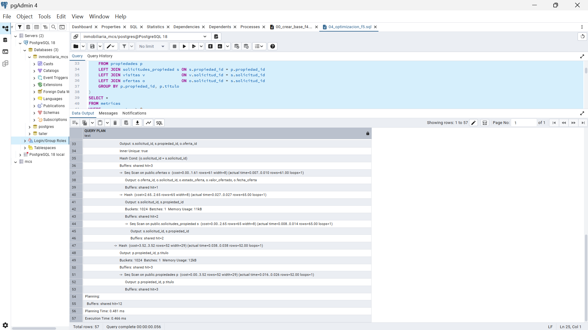
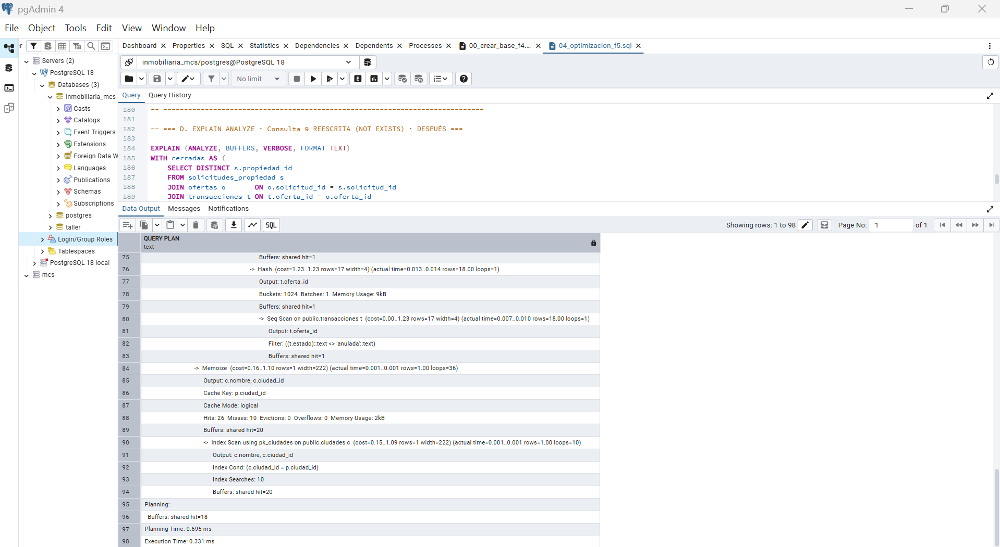
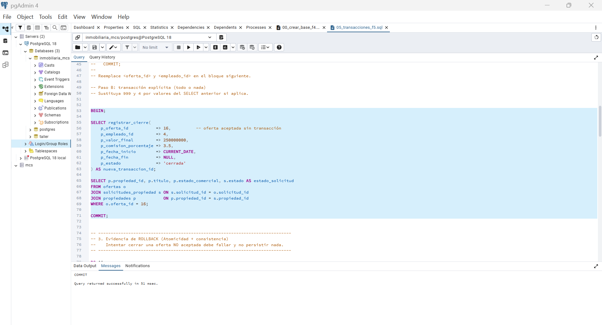
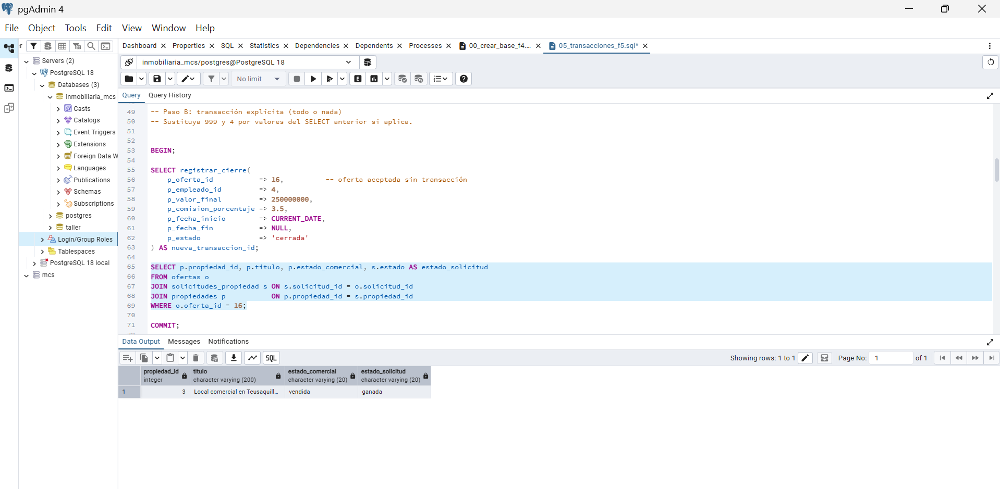
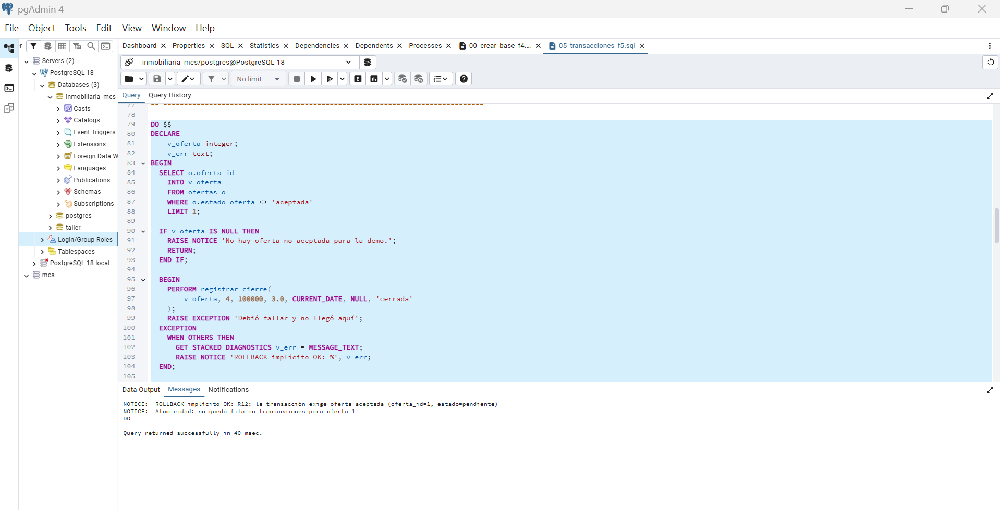

# Optimización y transacciones

**Equipo:** Harold Burgos, Sofía Camelo, Juan Triana  
**Base:** `inmobiliaria_mcs` (PostgreSQL 18)

Medimos dos consultas del portafolio (preguntas 7 y 9) y documentamos el cierre comercial como una sola transacción. Los scripts están en esta misma carpeta (`sql/04_optimizacion_f5.sql` y `sql/05_transacciones_f5.sql`). Los planes completos quedaron en `time.txt`.

## 1. Qué medimos

La carga de la fase 4 tiene cerca de 52 propiedades, 65 solicitudes, 88 visitas y 61 ofertas. Con ese tamaño, todas las ejecuciones quedaron por debajo de 0,5 ms. No vimos una mejora de órdenes de magnitud: los índices sirven por selectividad cuando el inventario crezca, no por los microsegundos de esta muestra. La consulta 7 no bajó de tiempo después de indexar, porque el motor sigue prefiriendo Seq Scan cuando cada tabla cabe en pocas páginas.

| Consulta | Fase | Planning Time | Execution Time | Qué hizo el plan |
|----------|------|---------------|----------------|------------------|
| 7 | Antes (A1) | 2.540 ms | 0.298 ms | GroupAggregate y Hash Join; Seq Scan en visitas, ofertas, solicitudes y propiedades |
| 7 | Después de índices (C1) | 1.175 ms | 0.428 ms | La misma estructura; el optimizador mantiene Seq Scan |
| 9 | Antes (A2) | 1.705 ms | 0.352 ms | Ventana RANK y anti-filtro NOT IN con Hash Join y Seq Scan |
| 9 | Después de índices (C2) | 1.929 ms | 0.264 ms | Sigue NOT IN; la ejecución bajó cerca de un 25 % |
| 9 reescrita con NOT EXISTS (D) | Después | 0.642 ms | 0.422 ms | Hash Anti Join e Index Scan sobre pk_ciudades |

## 2. Consultas que elegimos

### Consulta 7 (pregunta 7)

Cuenta, por propiedad, prospectos, visitas y ofertas con tres LEFT JOIN. Es la consulta que más tablas del proceso comercial toca.

Sin índice en `solicitudes_propiedad(propiedad_id)`, `visitas(solicitud_id)` y `ofertas(solicitud_id)`, el optimizador arma Hash Join sobre Sequential Scan. Con decenas de filas el tiempo se mantiene en microsegundos; con miles de solicitudes, un Index Scan reduce lecturas.

Creamos `idx_sol_propiedad_id`, `idx_visitas_solicitud_id` e `idx_ofertas_solicitud_id`. La ejecución pasó de 0.298 ms a 0.428 ms y el árbol siguió en Seq Scan. El segundo corrido puede variar por caché. La justificación de esos índices queda en la escala, no en el tiempo de esta muestra.

### Consulta 9 (pregunta 9)

Lista propiedades sin cierre y calcula antigüedad con la fecha de publicación y `RANK()`.

El `NOT IN` materializa los `propiedad_id` ya cerrados. Los índices de la cadena oferta → transacción aceleran esa subconsulta. El índice parcial `idx_publicaciones_propiedad_pub` apoya el mínimo de `fecha_publicacion` solo en avisos activos.

Además reescribimos el filtro como `NOT EXISTS` sobre una CTE `cerradas`, y el mínimo de fecha solo considera publicaciones vigentes. Con índices, la versión original bajó de 0.352 ms a 0.264 ms. La reescritura baja sobre todo el tiempo de planificación (0.642 ms frente a 1.7 ms) y el plan pasa a Hash Anti Join. Esa es la versión que dejamos para la pregunta 9.

## 3. Índices

| Índice | Tabla | Para qué lo usamos |
|--------|-------|--------------------|
| `idx_sol_propiedad_id` | solicitudes_propiedad | Unir solicitudes con el inmueble (pregunta 7) |
| `idx_sol_campana_id` | solicitudes_propiedad | Contar por campaña cuando hay campaña (pregunta 6) |
| `idx_sol_estado_activo` | solicitudes_propiedad | Pipeline de oportunidades abiertas (pregunta 3) |
| `idx_visitas_solicitud_id` | visitas | Unir visitas con la solicitud |
| `idx_ofertas_solicitud_id` | ofertas | Unir ofertas con la solicitud |
| `idx_ofertas_estado` | ofertas | Localizar ofertas aceptadas al cerrar |
| `idx_transacciones_oferta_id` | transacciones | Saber qué ofertas ya tienen cierre |
| `idx_publicaciones_propiedad_pub` | publicaciones | Precio vigente y antigüedad de avisos activos |

Estos índices quedan en la base después de correr el script 04.

## 4. El cierre como transacción

Registrar un cierre no es un solo INSERT. Al insertar en `transacciones`, el trigger `fn_validar_y_aplicar_transaccion`:

1. exige que la oferta esté `aceptada`;
2. marca la solicitud como `ganada`;
3. deja la propiedad en `vendida` o `no_disponible`, según la operación.

`registrar_cierre` hace el INSERT. El trigger corre en la misma transacción que abre el cliente con `BEGIN` y cierra con `COMMIT`. Si la oferta no está aceptada, la operación falla y no queda fila en `transacciones`.

Lo comprobamos con la oferta 16 (cierre correcto: propiedad 3 queda `vendida` y la solicitud `ganada`) y con la oferta 1, que está `pendiente`: el motor avisa que la regla R12 rechazó el cierre y que no quedó transacción.

### Dos cierres sobre el mismo inmueble

Si dos sesiones intentan cerrar dos ofertas distintas de la misma propiedad, sin bloqueo ambas pueden hacer COMMIT y el estado comercial queda con la última escritura.

`cerrar_venta_con_bloqueo` toma `FOR UPDATE` sobre la solicitud y la propiedad antes de llamar a `registrar_cierre`. La segunda sesión espera. Cuando la primera confirma, la segunda ve el estado ya actualizado. Evitamos una condición de carrera sobre el estado del inmueble, del mismo tipo que dos ventas simultáneas sobre un inventario.

### Aislamiento

El cierre operativo lo dejamos en **READ COMMITTED**, que es el nivel por defecto de PostgreSQL, más el bloqueo explícito de fila. Las consultas 7 y 9 también se leen en ese nivel: cada sentencia ve datos confirmados. Un reporte que necesitara los mismos conteos durante toda la sesión podría usar REPEATABLE READ; en esta base no hizo falta.

| Propiedad | Cómo la vemos en la base |
|-----------|--------------------------|
| Atomicidad | Si la oferta no está aceptada, no queda el INSERT |
| Consistencia | Llaves foráneas, CHECK y los triggers de dueño, estado y cierre; la comisión se calcula |
| Aislamiento | READ COMMITTED y `FOR UPDATE` en el cierre |
| Durabilidad | Después del COMMIT el cierre permanece |
