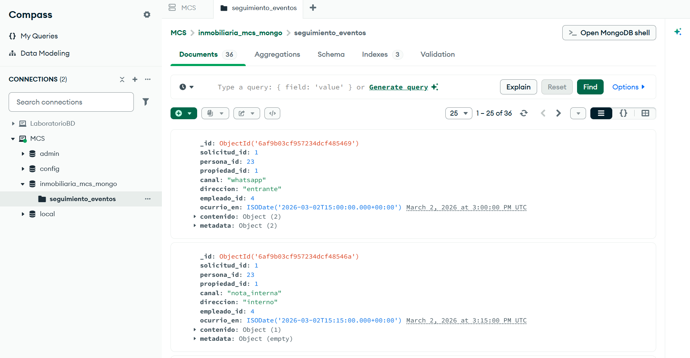
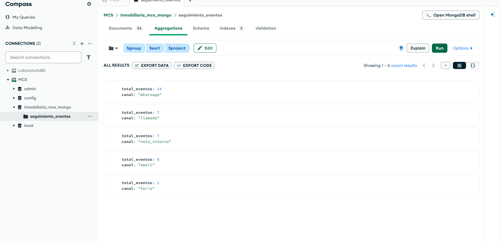
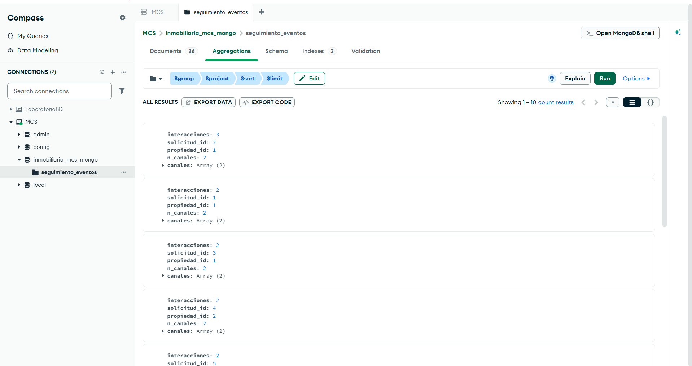

# Seguimiento en MongoDB

**Equipo:** Harold Burgos, Sofía Camelo, Juan Triana  
**Base:** `inmobiliaria_mcs_mongo`  
**Colección:** `seguimiento_eventos`  
**Referencia relacional:** PostgreSQL `inmobiliaria_mcs` (solo los identificadores enteros)

---

## 1. Por qué este fragmento va en NoSQL (y no en PostgreSQL)

En el modelo relacional las visitas son una actividad con fecha, duración y calificación. En la operación el asesor registra además:

- mensajes de **WhatsApp** con texto libre y metadatos variables;
- **llamadas** sin visita presencial;
- **notas internas** con campos opcionales (sentimiento, URL de adjunto, duración).

El esquema cambia según el canal y el historial crece sin tocar la tabla `visitas`. Por eso este fragmento vive en MongoDB: documentos con `contenido` y `metadata` flexibles.

Cada evento usa el `solicitud_id` de PostgreSQL y, con él, el `persona_id` y el `propiedad_id` de esa misma solicitud. No copiamos nombres, precios ni el canal de la campaña.

---

## 2. Diseño del documento

```json
{
  "solicitud_id": 2,
  "persona_id": 24,
  "propiedad_id": 1,
  "canal": "whatsapp",
  "direccion": "entrante",
  "empleado_id": 5,
  "ocurrio_en": { "$date": "2026-03-05T14:30:00Z" },
  "contenido": {
    "resumen": "Pide visita fin de semana",
    "mensaje": "¿Pueden mostrar el apartamento el sábado en la mañana?"
  },
  "metadata": {
    "duracion_seg": null,
    "sentimiento": "positivo",
    "adjuntos": []
  }
}
```

| Campo | Obligatorio | Descripción |
|-------|-------------|-------------|
| `solicitud_id` | sí | FK lógica → `solicitudes_propiedad` |
| `persona_id` | sí | Prospecto |
| `propiedad_id` | sí | Inmueble de la oportunidad |
| `canal` | sí | `whatsapp`, `llamada`, `email`, `nota_interna`, `feria` |
| `direccion` | sí | `entrante` / `saliente` / `interno` |
| `empleado_id` | no | Asesor que registró o atendió |
| `ocurrio_en` | sí | Fecha del hecho |
| `contenido` | sí | Subdocumento variable por canal |
| `metadata` | no | Extensión sin migración de esquema |

---

## 3. Índices

| Índice | Campos | Uso |
|--------|--------|-----|
| `idx_solicitud_fecha` | `{ solicitud_id: 1, ocurrio_en: -1 }` | Timeline de una oportunidad (pregunta 4–5 ampliada) |
| `idx_canal_fecha` | `{ canal: 1, ocurrio_en: -1 }` | Contar eventos de seguimiento por canal. No es el canal de marketing de PostgreSQL |

---

## 4. Cómo ejecutar en su máquina

### Opción A — mongosh

```text
mongosh
load("ruta/completa/codigo/mongodb/01_setup_y_carga_f6.js")
load("codigo/mongodb/02_crud_f6.js")
load("codigo/mongodb/03_agregaciones_f6.js")
```

En Windows, desde la carpeta del proyecto:

```text
mongosh --file "codigo\mongodb\01_setup_y_carga_f6.js"
```

### Opción B — MongoDB Compass

1. Crear base `inmobiliaria_mcs_mongo`.  
2. **Import** → `codigo/mongodb/seguimiento_eventos_seed.json` → colección `seguimiento_eventos`.  
3. **Indexes** → crear los dos índices anteriores.  
4. Pestaña **Aggregations** → pegar pipelines de `03_agregaciones_f6.js`.

---

## 5. CRUD (archivo `02_crud_f6.js`)

Demuestra **C**reate, **R**ead, **U**pdate, **D**elete sobre la misma colección, con comentarios que referencian `solicitud_id` existentes en PostgreSQL.

---

## 6. Dos agregaciones (archivo `03_agregaciones_f6.js`)

| # | Pregunta de negocio | Pipeline |
|---|---------------------|----------|
| A1 | ¿Qué **canales** concentran más **eventos** de seguimiento? | `$group` por `canal` + `$sort` |
| A2 | ¿Qué **oportunidades** (`solicitud_id`) tienen más interacciones registradas? | `$group` + `$sort` + `$limit` |

Estas agregaciones cuentan el seguimiento que no es una visita. No responden la pregunta 6: allí el canal es Meta Ads, feria o referidos. Aquí el canal es WhatsApp, llamada, correo, nota interna o feria.

---

## 7. Lo que vimos al cargar la colección

Cargamos 36 eventos con `scripts/seguimiento_eventos_seed.json`. Las fechas quedaron como fecha de MongoDB, no como texto.



La agregación por canal dio: WhatsApp 14, llamada 7, nota interna 7, correo 6 y feria 2.



La solicitud 2 sobre la propiedad 1 es la que más interacciones tiene (3). El resto del top tiene 2.

